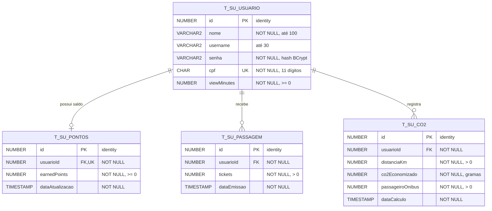
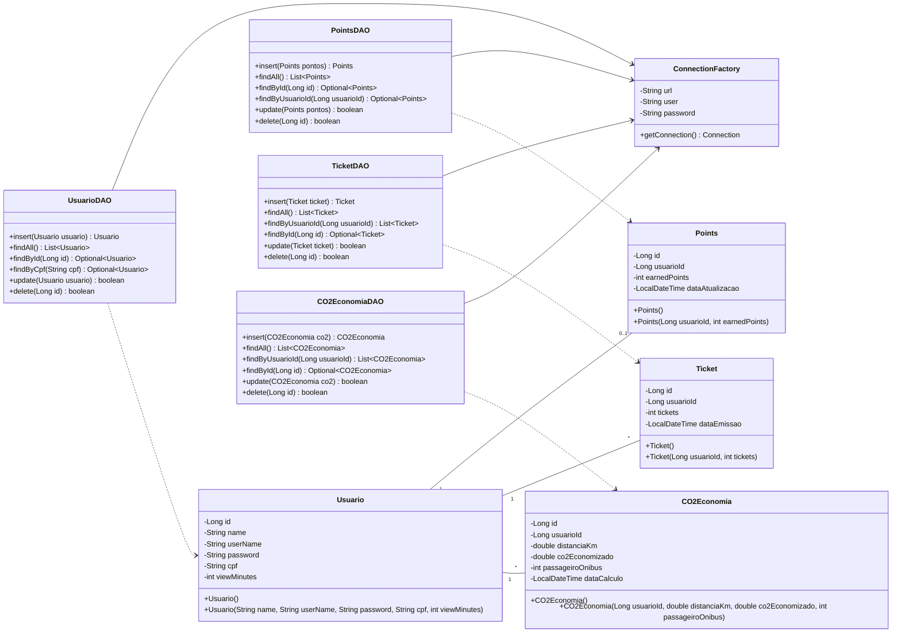
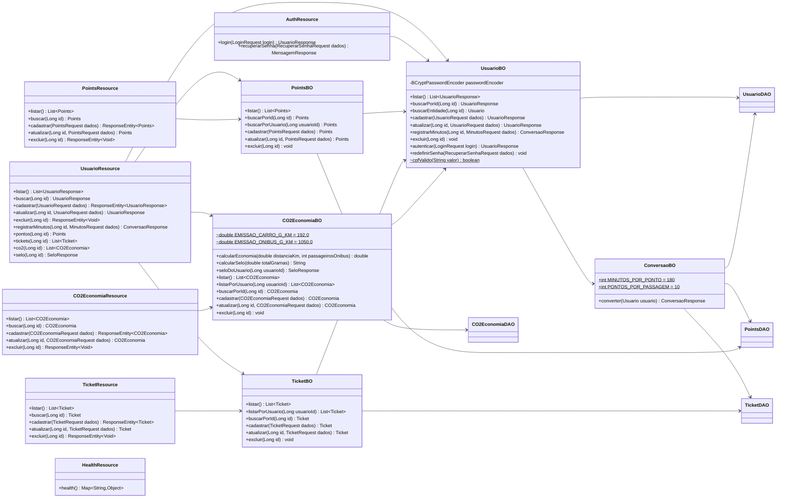
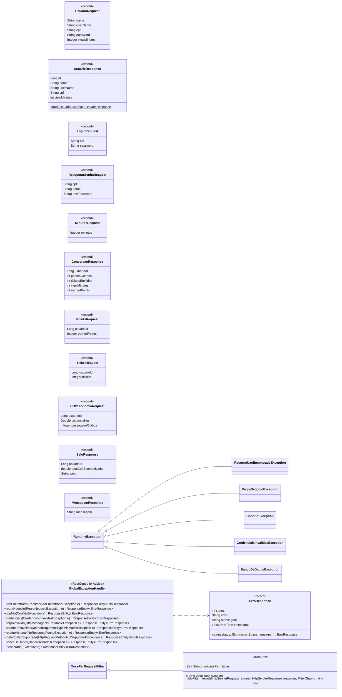

# SoulUp — Documentação da API

**FIAP · Análise e Desenvolvimento de Sistemas · Turma 1TDSPI · 2026**
**Disciplina:** Domain Driven Design Using Java
**Equipe:** TrustCorp
**Solução:** SoulUp — assista conteúdos, acumule pontos e transforme em mobilidade

| Integrante      | RM     | GitHub                                                            |
| --------------- | ------ | ----------------------------------------------------------------- |
| Henrique Soares | 573618 | [henriquesoaresserra-h](https://github.com/henriquesoaresserra-h) |
| Vinicius Soares | 573351 | [vinisl2510-sudo](https://github.com/vinisl2510-sudo)             |
| Nicolas Frazão  | 568780 | [Frazaomol](https://github.com/Frazaomol)                         |
| Cauã Bertini    | 570451 | [cauabertini](https://github.com/cauabertini)                     |

- Repositório da API: <https://github.com/Challenge-Trust/java-challenge2>
- Repositório do front-end: <https://github.com/Challenge-Trust/Challenge-FrontEnd>
- API publicada: <https://soulup-api-6rv6.onrender.com>
- Front-end publicado: <https://soulup-trustcorp.vercel.app>

<div style="page-break-after: always;"></div>

## 1. Objetivo e escopo

A SoulUp é uma rede social de impacto que transforma o tempo investido em conteúdo educativo em
mobilidade urbana. O usuário registra os minutos assistidos e o sistema os converte em pontos e,
depois, em tickets de transporte público. A solução também incentiva o uso do ônibus, calculando
quanto CO₂ o usuário deixou de emitir em relação ao mesmo trajeto feito de carro e concedendo um
selo sustentável.

Esta API REST, escrita em Java com Spring Boot, é o back-end da solução:

- persiste usuários, saldos de pontos, tickets emitidos e cálculos de CO₂ em um banco **Oracle**;
- concentra as **regras de negócio** (conversões, cálculo de CO₂, selo, validações);
- é consumida pelo front-end em React publicado na Vercel.

**Fora do escopo:** player de vídeo, emissão física de bilhetes e integração com operadoras de
transporte (os tickets são registrados no sistema).

## 2. Principais funcionalidades

1. **Cadastro e autenticação de usuários** — CPF validado (dígitos verificadores) e único, senha
   armazenada com hash **BCrypt**, login por CPF + senha e redefinição de senha por CPF + nome.
   O CPF nunca é devolvido completo pela API: as respostas trazem só o formato mascarado
   `***.982.247-**` (proteção de dado pessoal, LGPD).
2. **Conversão de minutos em pontos e tickets** — a cada **180 minutos** assistidos o usuário
   ganha **1 ponto**; a cada **10 pontos** recebe **1 ticket**. Os minutos e pontos que sobram ficam
   guardados para a próxima conversão.
3. **Cálculo de CO₂ economizado** — economia (g) = (192 g/km do carro − 1050 g/km do ônibus ÷
   passageiros) × km.
4. **Selo sustentável** — pelo total economizado: **Ouro** a partir de 100 kg, **Prata** a partir de
   50 kg, **Bronze** abaixo disso.
5. **CRUD completo** de usuários, pontos, tickets e cálculos de CO₂.
6. **Erros padronizados** em JSON e **CORS** liberado para o front (local e Vercel).
7. **Health check** em `GET /health` para o deploy.

## 3. Arquitetura

Projeto Spring Boot organizado em camadas (MVC + DAO), com acesso a dados via **JDBC puro**
(`PreparedStatement`), sem JPA:

```
Resource (REST)  →  BO (regras/validações)  →  DAO (SQL)  →  ConnectionFactory  →  Oracle
        ↘ DTOs de entrada/saída           ↘ exceções → GlobalExceptionHandler → JSON de erro
```

| Pacote      | Responsabilidade                                                                  |
| ----------- | --------------------------------------------------------------------------------- |
| `model`     | Entidades que representam as tabelas (`Usuario`, `Points`, `Ticket`, `CO2Economia`) |
| `factory`   | `ConnectionFactory`: abre conexões com o Oracle a partir de variáveis de ambiente |
| `dao`       | Um DAO por entidade com `insert`, `findAll`, `findById`, `update`, `delete`       |
| `bo`        | Regras de negócio e validações; único ponto que decide status 400/404/409         |
| `resource`  | Controllers REST (sem regra de negócio e sem SQL)                                 |
| `dto`       | Records de entrada (`*Request`) e saída (`*Response`); a senha nunca é exposta e o CPF sai mascarado (`***.982.247-**`) |
| `exception` | Exceções customizadas + `GlobalExceptionHandler` (`@RestControllerAdvice`)        |
| `config`    | `CorsFilter`                                                                      |

<div style="page-break-after: always;"></div>

## 4. Endpoints

Base local: `http://localhost:8080` · Base em produção: `https://soulup-api-6rv6.onrender.com`
Todas as respostas são JSON (camelCase). Datas no formato ISO-8601 (`2026-10-29T21:53:25`).

### 4.1 Usuários

| URI                            | Verbo  | Descrição                                       | Corpo (JSON)                                                 | Status esperados        |
| ------------------------------ | ------ | ----------------------------------------------- | ------------------------------------------------------------ | ----------------------- |
| `/api/usuarios`                | GET    | Lista os usuários                               | —                                                            | 200, 500                |
| `/api/usuarios/{id}`           | GET    | Busca um usuário                                | —                                                            | 200, 400, 404, 500      |
| `/api/usuarios`                | POST   | Cadastra e já converte os minutos informados    | `{ "name", "userName"?, "cpf", "password", "viewMinutes" }`  | 201 + `Location`, 400, 409, 500 |
| `/api/usuarios/{id}`           | PUT    | Atualiza (CPF e senha opcionais)                | `{ "name", "userName"?, "cpf"?, "password"?, "viewMinutes" }` | 200, 400, 404, 409, 500 |
| `/api/usuarios/{id}`           | DELETE | Exclui o usuário (e, em cascata, seus registros) | —                                                           | 204, 404, 500           |
| `/api/usuarios/{id}/minutos`   | POST   | Credita minutos assistidos e converte           | `{ "minutos": 360 }` (1 a 1440)                              | 200, 400, 404, 500      |
| `/api/usuarios/{id}/pontos`    | GET    | Saldo de pontos do usuário                      | —                                                            | 200, 404, 500           |
| `/api/usuarios/{id}/tickets`   | GET    | Tickets emitidos para o usuário                 | —                                                            | 200, 404, 500           |
| `/api/usuarios/{id}/co2`       | GET    | Cálculos de CO₂ do usuário                      | —                                                            | 200, 404, 500           |
| `/api/usuarios/{id}/selo`      | GET    | Total de CO₂ (g) e selo sustentável             | —                                                            | 200, 404, 500           |

### 4.2 Autenticação

| URI                         | Verbo | Descrição                           | Corpo (JSON)                              | Status esperados   |
| --------------------------- | ----- | ----------------------------------- | ----------------------------------------- | ------------------ |
| `/api/auth/login`           | POST  | Login por CPF e senha               | `{ "cpf", "password" }`                   | 200, 400, 401, 500 |
| `/api/auth/recuperar-senha` | POST  | Redefine a senha (CPF + nome)       | `{ "cpf", "name", "newPassword" }`        | 200, 400, 404, 500 |

### 4.3 Pontos, tickets e CO₂

| URI                 | Verbo  | Descrição                               | Corpo (JSON)                                          | Status esperados                |
| ------------------- | ------ | --------------------------------------- | ----------------------------------------------------- | ------------------------------- |
| `/api/pontos`       | GET    | Lista os saldos de pontos               | —                                                     | 200, 500                        |
| `/api/pontos/{id}`  | GET    | Busca um saldo                          | —                                                     | 200, 400, 404, 500              |
| `/api/pontos`       | POST   | Cria o saldo de um usuário (1 por usuário) | `{ "usuarioId", "earnedPoints" }`                  | 201 + `Location`, 400, 404, 409, 500 |
| `/api/pontos/{id}`  | PUT    | Atualiza um saldo                       | `{ "usuarioId", "earnedPoints" }`                     | 200, 400, 404, 409, 500         |
| `/api/pontos/{id}`  | DELETE | Exclui um saldo                         | —                                                     | 204, 404, 500                   |
| `/api/tickets`      | GET    | Lista os tickets emitidos               | —                                                     | 200, 500                        |
| `/api/tickets/{id}` | GET    | Busca um registro de tickets            | —                                                     | 200, 400, 404, 500              |
| `/api/tickets`      | POST   | Emite tickets para um usuário           | `{ "usuarioId", "tickets" }`                          | 201 + `Location`, 400, 404, 500 |
| `/api/tickets/{id}` | PUT    | Atualiza um registro de tickets         | `{ "usuarioId", "tickets" }`                          | 200, 400, 404, 500              |
| `/api/tickets/{id}` | DELETE | Exclui um registro de tickets           | —                                                     | 204, 404, 500                   |
| `/api/co2`          | GET    | Lista os cálculos de CO₂                | —                                                     | 200, 500                        |
| `/api/co2/{id}`     | GET    | Busca um cálculo                        | —                                                     | 200, 400, 404, 500              |
| `/api/co2`          | POST   | Registra uma viagem e calcula o CO₂     | `{ "usuarioId", "distanciaKm", "passageiroOnibus" }`  | 201 + `Location`, 400, 404, 500 |
| `/api/co2/{id}`     | PUT    | Atualiza e recalcula                    | `{ "usuarioId", "distanciaKm", "passageiroOnibus" }`  | 200, 400, 404, 500              |
| `/api/co2/{id}`     | DELETE | Exclui um cálculo                       | —                                                     | 204, 404, 500                   |
| `/health`           | GET    | Verificação de saúde                    | —                                                     | 200                             |

### 4.4 Exemplos

`POST /api/usuarios`

```json
{ "name": "Carla Dias", "cpf": "39053344705", "password": "abc12345", "viewMinutes": 2000 }
```

Resposta `201 Created` (`Location: /api/usuarios/3`) — 2000 min viraram 11 pontos → 1 ticket e
sobraram 1 ponto e 20 minutos:

```json
{ "id": 3, "name": "Carla Dias", "userName": null, "cpf": "***.053.344-**", "viewMinutes": 20 }
```

Erro padronizado (ex.: CPF repetido):

```json
{
  "status": 409,
  "erro": "Conflito",
  "mensagem": "Já existe um usuário cadastrado com esse CPF.",
  "timestamp": "2026-10-29T21:53:20.595"
}
```

<div style="page-break-after: always;"></div>

## 5. Protótipo

Telas do front-end (React + Vite + Tailwind) que consomem esta API.

| Tela                                   | Print                                  |
| -------------------------------------- | -------------------------------------- |
| Home (`/`)                             | **[INSERIR PRINT]**                    |
| Criar conta (`/cadastro`)              | **[INSERIR PRINT]**                    |
| Login (`/login`)                       | **[INSERIR PRINT]**                    |
| Meu painel (`/painel`)                 | **[INSERIR PRINT]**                    |
| Usuários — lista (`/usuarios`)         | **[INSERIR PRINT]**                    |
| Usuário — detalhe (`/usuarios/:id`)    | **[INSERIR PRINT]**                    |
| Usuário — edição (`/usuarios/:id/editar`) | **[INSERIR PRINT]**                 |
| Viagens (`/viagens`)                   | **[INSERIR PRINT]**                    |
| Nova viagem (`/viagens/nova`)          | **[INSERIR PRINT]**                    |
| Conversão (`/conversao`)               | **[INSERIR PRINT]**                    |
| Versão mobile (menu hambúrguer)        | **[INSERIR PRINT]**                    |

## 6. Modelo Entidade-Relacionamento (MER)

Script completo (DDL + dados de exemplo): [`script.sql`](script.sql).



Todas as FKs usam `ON DELETE CASCADE`: excluir um usuário remove seu saldo, tickets e cálculos.

| Tabela          | Classe model  | Colunas → atributos                                                                                                   |
| --------------- | ------------- | --------------------------------------------------------------------------------------------------------------------- |
| `T_SU_USUARIO`  | `Usuario`     | id → id, nome → name, username → userName, senha → password, cpf → cpf, viewMinutes → viewMinutes                     |
| `T_SU_PONTOS`   | `Points`      | id, usuarioId, earnedPoints, dataAtualizacao (mesmos nomes)                                                            |
| `T_SU_PASSAGEM` | `Ticket`      | id, usuarioId, tickets, dataEmissao (mesmos nomes)                                                                     |
| `T_SU_CO2`      | `CO2Economia` | id, usuarioId, distanciaKm, co2Economizado, passageiroOnibus, dataCalculo (mesmos nomes)                               |

<div style="page-break-after: always;"></div>

## 7. Diagrama de classes

Gerado a partir do código final (pacote `br.com.fiap.soulup`). Os getters e setters dos models
foram omitidos para legibilidade: todo atributo privado tem `get`/`set` correspondente.

### 7.1 Model, DAO e ConnectionFactory



### 7.2 BO (regras de negócio) e Resource (REST)



### 7.3 DTOs, exceções e configuração



| Exceção                         | Status HTTP | Quando                                                      |
| ------------------------------- | ----------- | ----------------------------------------------------------- |
| `RegraNegocioException`         | 400         | Dados inválidos (CPF, senha, minutos, distância…)           |
| `CredenciaisInvalidasException` | 401         | CPF ou senha incorretos no login                            |
| `RecursoNaoEncontradoException` | 404         | Id inexistente                                              |
| `ConflitoException`             | 409         | CPF já cadastrado / usuário que já tem saldo de pontos      |
| `BancoDeDadosException`         | 500         | Falha de JDBC (a `SQLException` original vai para o log)    |

<div style="page-break-after: always;"></div>

## 8. Como rodar

### 8.1 Ferramentas

| Ferramenta     | Versão                                                                 |
| -------------- | ---------------------------------------------------------------------- |
| JDK            | 21 (LTS) — ex.: Eclipse Temurin 21                                     |
| Maven          | 3.9+ — já incluso via Maven Wrapper (`mvnw` / `mvnw.cmd`)              |
| Spring Boot    | 3.5.16                                                                 |
| Banco          | Oracle (FIAP `oracle.fiap.com.br` ou Oracle Free em Docker)           |
| IDE sugerida   | IntelliJ IDEA                                                          |
| Cliente SQL    | Oracle SQL Developer                                                   |
| Deploy         | Docker + Render                                                        |

### 8.2 Importar o projeto

1. `git clone https://github.com/Challenge-Trust/java-challenge2.git`
2. No IntelliJ: **File → Open** e selecione a pasta (o `pom.xml` é detectado como projeto Maven).
3. Em **File → Project Structure → SDK**, escolha o JDK 21.

### 8.3 Banco de dados

1. Conecte no Oracle pelo SQL Developer com seu usuário.
2. Abra e execute o [`script.sql`](script.sql) (**F5 – Executar Script**). Ele recria as tabelas e
   insere 2 usuários de exemplo (senha `senha123`).

### 8.4 Variáveis de ambiente

| Variável      | Obrigatória | Exemplo                                              |
| ------------- | ----------- | ---------------------------------------------------- |
| `DB_URL`      | sim         | `jdbc:oracle:thin:@oracle.fiap.com.br:1521:ORCL`     |
| `DB_USER`     | sim         | `rm573351`                                           |
| `DB_PASSWORD` | sim         | senha do Oracle                                      |
| `FRONT_URL`   | não (local) | `https://soulup.vercel.app` (aceita várias, separadas por vírgula) |
| `PORT`        | não         | `8080` (o Render define sozinho)                     |

No IntelliJ: **Run → Edit Configurations → Environment variables**.

### 8.5 Execução local

```bash
./mvnw spring-boot:run        # Linux, macOS ou Git Bash
mvnw.cmd spring-boot:run      # Windows (cmd/PowerShell)
```

Teste em <http://localhost:8080/health> e <http://localhost:8080/api/usuarios>.
O front-end em `http://localhost:5173` já está liberado no `CorsFilter`.

### 8.6 Produção (Render)

1. Em <https://render.com>: **New → Web Service** e conecte o repositório `java-challenge2`.
2. **Language/Runtime:** Docker (o `Dockerfile` multi-stage compila com Maven e roda na JRE 21).
3. **Instance type:** Free. **Health Check Path:** `/health`.
4. **Environment:** cadastre `DB_URL`, `DB_USER`, `DB_PASSWORD` e `FRONT_URL`.
5. Crie o serviço e aguarde o build. A URL fica no formato `https://<nome>.onrender.com`.
6. Coloque essa URL em `VITE_API_URL` na Vercel e refaça o deploy do front.

> No plano gratuito a API "dorme" após 15 minutos sem uso; a primeira requisição pode levar até
> 1 minuto. O front exibe um aviso nesse caso.
